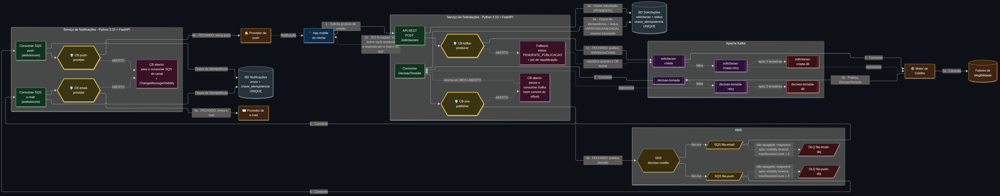
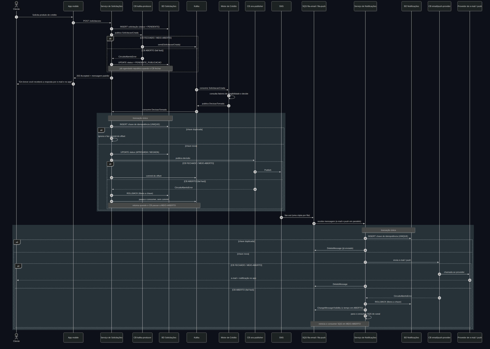
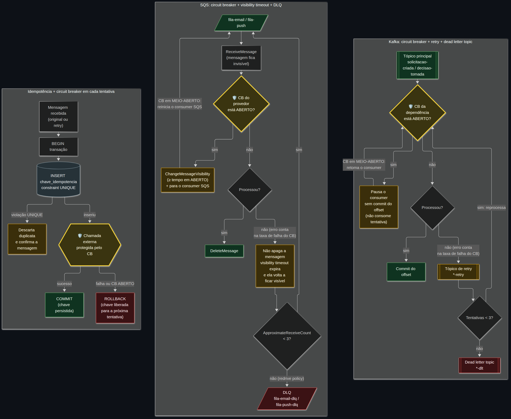
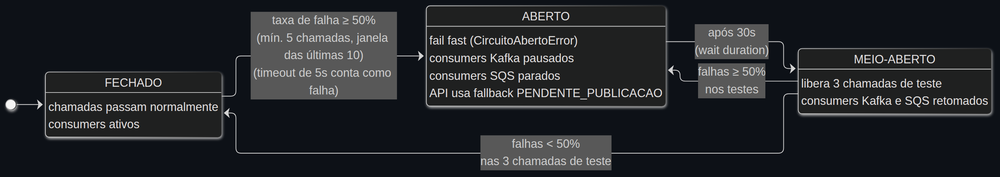

# Fluxo de Crédito (Python)

Solicitação **assíncrona** de um produto de crédito, mesmo quando o cliente não o tem no catálogo. A resposta chega por **e-mail** e por **notificação no app**.

Versão em **Python 3.15** da solução [`fluxo-de-credito`](https://github.com/rafaelzucon/fluxo-de-credito) (Java 21 + Spring), também disponível em [Node.js](https://github.com/rafaelzucon/fluxo-de-credito-nodejs). Ela mantém a mesma API, os mesmos eventos, tópicos, filas e tabelas.

Resiliência: **chaves de idempotência** (constraint `UNIQUE`), **retry/DLT** no Kafka, **visibility timeout/DLQ** no SQS e **circuit breakers** nas chamadas externas.



## Componentes

| Componente | Responsabilidade |
|---|---|
| **App mobile** | Envia a solicitação e recebe a notificação push. |
| **Serviço de Solicitações** (Python) | Grava a solicitação, publica `SolicitacaoCriada` no Kafka e responde com uma mensagem padrão. Depois consome `DecisaoTomada`, atualiza o status e publica a decisão no SNS. |
| **Motor de Crédito** | Consome `SolicitacaoCriada`, consulta os fatores de elegibilidade, decide e publica `DecisaoTomada`. |
| **SNS → SQS** | Faz o fan-out da decisão para as filas `fila-email` e `fila-push`. |
| **Serviço de Notificações** (Python) | Consome as filas SQS e envia o e-mail e a notificação push. |

## Versões

| Tecnologia | Versão |
|---|---|
| Python | **3.15.2**, totalmente `asyncio` |
| Gerenciador de pacotes | uv 0.13 (workspace com 4 pacotes e `uv.lock`) |
| HTTP | FastAPI 0.162 + Uvicorn 0.54; validação com Pydantic 2.14 |
| Configuração | pydantic-settings 2.16 (variáveis de ambiente) |
| Kafka | aiokafka 0.15 (produtor idempotente, `acks=all`), broker Apache Kafka 4.4 (KRaft) |
| SNS / SQS | aiobotocore 3.10 (botocore 1.43) |
| Banco de dados | Oracle Database 23ai Free, `oracledb` 26.1 (modo Thin assíncrono, sem Instant Client) |
| Circuit breaker | Implementação própria, assíncrona, no modelo do Resilience4j (`packages/comum/src/comum/circuit_breaker.py`) |
| E-mail / push | aiosmtplib 5.1 (SMTP → Mailpit) / httpx2 2.16 (REST → WireMock) |
| Logs | structlog 26.1 (JSON) |
| Qualidade | pytest 9.2 + pytest-asyncio 1.4, Ruff 0.17, mypy 2.4 (`strict`) |
| Infra local | LocalStack 4.14 (SNS/SQS), Mailpit 1.33 (SMTP), WireMock 3.13 (provedor de push) |

**Por que um circuit breaker próprio?** As bibliotecas Python disponíveis (pybreaker, aiobreaker, purgatory) contam falhas consecutivas e não oferecem janela deslizante com **percentual** de falhas, **mínimo de chamadas**, **timeout** nem **N chamadas de teste** em MEIO-ABERTO. A implementação própria tem cerca de 200 linhas, é coberta por testes e usa os mesmos parâmetros do Resilience4j da versão Java.

## Circuit breakers

| Circuit breaker | Serviço | Protege | Quando está ABERTO |
|---|---|---|---|
| `kafka-producer` | Solicitações | Publicação de `SolicitacaoCriada` | **Fallback:** grava o status `PENDENTE_PUBLICACAO` e responde `202` mesmo assim. Um job (a cada 15 s) republica quando o CB não está aberto. |
| `sns-publisher` | Solicitações | Publicação da decisão no SNS | Rollback da transação e pausa dos consumers Kafka de `decisao-tomada`, sem commit do offset. A mensagem é reprocessada sem gastar tentativa; o consumo é retomado em MEIO-ABERTO. |
| `email-provider` | Notificações | Provedor de e-mail (SMTP) | Rollback, `ChangeMessageVisibility(30 s)` e parada do consumer da `fila-email`; ele é reiniciado em MEIO-ABERTO. |
| `push-provider` | Notificações | Provedor de push (REST) | O mesmo comportamento, no consumer da `fila-push`. Cada canal falha de forma independente. |

**Como os mecanismos se combinam:**

- **CB + retry/DLQ:** com o CB aberto, o consumer é pausado em vez de gastar as 3 tentativas. Assim, uma indisponibilidade prolongada não leva mensagens válidas para a DLT/DLQ. Erros reais continuam contando na taxa de falha do CB e seguem o fluxo normal de retry.
- **CB + idempotência:** a chave é inserida na mesma transação da chamada externa. Se a chamada falha ou o CB está aberto, o rollback libera a chave e a próxima tentativa não é descartada como duplicata.
- **Visibility timeout (30 s)** é maior ou igual ao tempo em ABERTO (30 s). Assim, a mensagem não reaparece enquanto o CB ainda está aberto.

Configuração padrão (variáveis de ambiente, em `packages/comum/src/comum/config.py`):

| Variável | Padrão | Significado |
|---|---|---|
| `CB_JANELA_CHAMADAS` | `10` | Tamanho da janela deslizante (últimas N chamadas) |
| `CB_LIMITE_FALHAS_PERCENTUAL` | `50` | Percentual de falhas na janela que abre o circuito |
| `CB_MINIMO_CHAMADAS` | `5` | Mínimo de chamadas na janela antes de avaliar o percentual |
| `CB_TEMPO_ABERTO_MS` | `30000` | Tempo em ABERTO antes de ir para MEIO-ABERTO |
| `CB_CHAMADAS_MEIO_ABERTO` | `3` | Chamadas de teste em MEIO-ABERTO; fecha se a taxa de falha delas ficar abaixo do limite |
| `CB_TIMEOUT_MS` | `5000` | Chamada mais lenta que isso é cancelada e conta como falha (no `kafka-producer`, vale `KAFKA_TIMEOUT_PUBLICACAO_MS` = 10 s) |

## Retry no Kafka

O consumer de `decisao-tomada` (Solicitações) e o de `solicitacao-criada` (motor) seguem o mesmo fluxo, implementado em `ConsumidorComRetry` (`packages/comum/src/comum/kafka.py`):

1. A falha no tópico principal envia a mensagem para `<topico>-retry`, com os headers `tentativa`, `processar-apos`, `erro` e `topico-original`. O offset é confirmado em seguida.
2. O consumer de retry espera até `processar-apos`, que fica 5 s depois da falha, e processa de novo.
3. Depois de 3 retries (4 tentativas no total), a mensagem vai para `<topico>-dlt`. Mensagens inválidas (JSON ou campos obrigatórios) vão direto para a DLT.

Os commits são manuais (`enable_auto_commit=False`) e só acontecem depois do processamento ou do encaminhamento.

## Código e execução

### Estrutura (workspace uv)

| Pacote | Porta | Conteúdo |
|---|---|---|
| `packages/comum` | – | Circuit breaker, Kafka (produtor idempotente, criação de tópicos, consumer com retry/DLT), Oracle (pool, transações, migrações `V<n>__*.sql`), FastAPI (`/health`, `/circuit-breakers`), logs e dublês de teste. |
| `packages/solicitacao-service` | 8080 | API REST (`POST/GET /api/v1/solicitacoes`), repositório Oracle com versão otimista, producer `SolicitacaoCriada`, consumer `DecisaoTomada`, publicação no SNS, idempotência, job de republicação e CBs `kafka-producer`/`sns-publisher`. |
| `packages/notificacao-service` | 8081 | Consumers SQS `fila-email`/`fila-push` (long polling), envio SMTP e push (REST), idempotência por canal (`email:{id}`, `push:{id}`) e CBs `email-provider`/`push-provider`. |
| `packages/motor-credito-simulador` | 8082 | Simula o motor de crédito, que é um sistema externo à solução. |

**Regras do simulador** (as mesmas das versões Java e Node.js):

- `clienteId` iniciado por `restrito` → NEGADA ("Restrição cadastral").
- Para os demais clientes, o score e o limite são derivados de `String.hashCode()` do `clienteId`, reproduzido em Python:
  - score < 500 → NEGADA;
  - valor acima do limite → NEGADA;
  - caso contrário, APROVADA.
- Exemplos: `cliente-123` tem limite de R$ 34.000; `maria.silva`, de R$ 48.000.

### Executar com Docker

Pré-requisitos: Linux com Docker Engine e Docker Compose v2, cerca de **6 GB de RAM** e **7 GB de disco livres**. Os datafiles do Oracle ocupam cerca de 3,2 GB.

```bash
docker compose up -d --build        # roda ruff, mypy e os testes unitários e sobe tudo
docker compose ps                   # aguarde todos ficarem "healthy" (o Oracle leva 1–2 min na 1ª vez)
```

Para pular a verificação no build: `SKIP_TESTS=true docker compose up -d --build`.
Se a sua rede usa proxy com inspeção TLS, copie os certificados da CA (`*.crt`) para `docker/certs/` antes do build.

| Endereço | O que é |
|---|---|
| http://localhost:8080/api/v1/solicitacoes | API de solicitações |
| http://localhost:8080/docs | Swagger UI (OpenAPI gerado pelo FastAPI) |
| http://localhost:8025 | Mailpit: e-mails enviados |
| http://localhost:8089/__admin/requests | WireMock: notificações push recebidas |
| http://localhost:8080/circuit-breakers (e 8081) | Estado dos circuit breakers |
| http://localhost:8080/health (8081, 8082) | Saúde dos serviços |
| `localhost:1521/FREEPDB1` | Oracle (usuários `solicitacao`/`solicitacao` e `notificacao`/`notificacao`) |
| `localhost:29092` | Kafka |
| `localhost:4566` | LocalStack (SNS/SQS) |

```bash
# 1. Solicitar (retorna 202 + mensagem padrão)
curl -i -X POST localhost:8080/api/v1/solicitacoes -H 'Content-Type: application/json' -d '{
  "clienteId": "cliente-123", "produtoCodigo": "CARTAO-GOLD", "valorSolicitado": 1000.00,
  "email": "maria@exemplo.com", "tokenDispositivo": "token-maria"}'

# 2. Consultar o status (PENDENTE → APROVADA/NEGADA)
curl localhost:8080/api/v1/solicitacoes/<solicitacaoId>

# 3. Ver a resposta ao cliente: e-mail em http://localhost:8025 e push no WireMock
curl localhost:8089/__admin/requests
```

**Simular falhas:**

```bash
# Circuit breaker + SQS: o provedor de push responde 503 → o CB push-provider abre, o consumer da fila-push
# é parado e as mensagens ficam na fila. Ao remover o stub, o CB vai para MEIO-ABERTO, fecha e os pushes são entregues.
ID=$(curl -s -X POST localhost:8089/__admin/mappings \
  -d '{"priority":1,"request":{"method":"POST","url":"/v1/push"},"response":{"status":503}}' | jq -r .id)
#   ...faça 6 solicitações...
curl localhost:8081/circuit-breakers
curl -X DELETE localhost:8089/__admin/mappings/$ID    # aguarde ~30 s

# DLQ: uma mensagem que nunca é processada vai para a DLQ no 3º recebimento (~90 s)
docker compose exec localstack awslocal sqs send-message \
  --queue-url http://localhost:4566/000000000000/fila-email --message-body 'invalida'
docker compose exec localstack awslocal sqs get-queue-attributes \
  --queue-url http://localhost:4566/000000000000/fila-email-dlq --attribute-names ApproximateNumberOfMessages

# Retry + DLT no Kafka: decisão de uma solicitação inexistente → 3 retries (5 s cada) → decisao-tomada-dlt
echo 'x|{"eventoId":"e1","solicitacaoId":"inexistente","decisao":"APROVADA","motivo":"m","decididoEm":"2026-01-01T00:00:00Z"}' | \
  docker compose exec -T kafka /opt/kafka/bin/kafka-console-producer.sh --bootstrap-server localhost:9092 \
  --topic decisao-tomada --reader-property parse.key=true --reader-property key.separator='|'
docker compose logs solicitacao-service | grep -E 'retry|dead letter'

# Idempotência: reenviar a mesma decisão (mesmo solicitacaoId) é ignorado ("mensagem duplicada ignorada")

# CB sns-publisher: isole o LocalStack da rede (preservando o estado), faça solicitações e reconecte
docker network disconnect fluxo-de-credito-py_default fluxo-de-credito-py-localstack-1
curl localhost:8080/circuit-breakers
docker network connect --alias localstack fluxo-de-credito-py_default fluxo-de-credito-py-localstack-1

# CB kafka-producer (fallback): com o Kafka pausado, as solicitações respondem 202 e ficam PENDENTE_PUBLICACAO;
# depois de retomar o Kafka, o job de republicação as publica e o fluxo segue normalmente
docker compose pause kafka
#   ...faça 6 solicitações e consulte o status...
docker compose unpause kafka
```

Para parar: `docker compose down` (ou `docker compose down -v` para apagar também o banco).

### Testes unitários

São 125 testes com pytest. Não precisam de Docker, Kafka, Oracle nem AWS: as dependências são substituídas por dublês (`comum.testes`).

```bash
uv sync --all-packages
uv run pytest                                    # só os testes
uv run ruff check packages && uv run mypy        # lint + checagem de tipos (strict)
# ou, sem Python local:
docker build --target verificacao .
```

### Observações

- **Imagens enxutas:** cada imagem contém apenas o ambiente virtual do serviço (`uv sync --no-dev --no-editable --package <serviço>`), sem o código-fonte do workspace nem as dependências de desenvolvimento, e roda com um usuário sem privilégios.
- **Ciclo de vida:** os recursos (pool Oracle, produtor/consumers Kafka, clientes AWS, jobs) são criados e fechados no `lifespan` do FastAPI. No `SIGTERM`, os consumers param, a mensagem em processamento termina e as conexões são fechadas.
- **Timeout de publicação no Kafka:** quando a publicação excede o timeout, a solicitação fica `PENDENTE_PUBLICACAO`, mas o produtor ainda pode entregar a mensagem quando o broker voltar. A republicação gera então uma duplicata, que é absorvida pela chave de idempotência (entrega *at-least-once*).
- **LocalStack 4.14:** as versões mais novas exigem `LOCALSTACK_AUTH_TOKEN`; a 4.14 é a última que roda sem conta. O LocalStack não persiste o estado, então reiniciar o container recria tópico e filas vazios. Para simular uma queda do SNS, use `docker network disconnect`, como no exemplo acima.
- **Contagem de recebimentos no SQS:** cada recebimento incrementa `ApproximateReceiveCount`, mesmo com o CB aberto. Para não gastar as 3 tentativas durante uma indisponibilidade, o consumer é parado quando o CB abre e a visibilidade da mensagem em processamento é estendida para 30 s. Mesmo assim, uma indisponibilidade muito longa, com reaberturas sucessivas do CB, pode levar mensagens à DLQ. Por isso, monitore as DLQs e reprocesse-as (redrive).
- **Tópicos Kafka:** são criados na inicialização com 3 partições: o principal, `-retry` e `-dlt`. A chave da mensagem é o `solicitacaoId`, o que garante a ordem por solicitação.
- **Instantes no Oracle:** são gravados e lidos sempre em UTC (`TO_TIMESTAMP_TZ` / `SYS_EXTRACT_UTC`), independentemente do fuso da sessão.
- **Migrações:** os serviços aplicam `migrations/V<n>__*.sql` (empacotadas no próprio pacote Python) na inicialização, no estilo Flyway, com a tabela `historico_migracao`.

## Diagramas

### 1. Visão geral da arquitetura


### 2. Sequência (idempotência + circuit breaker)



### 3. Tratamento de falhas



### 4. Estados do circuit breaker



## Arquivos

- `packages/*/src`, `packages/*/tests`: código e testes
- `pyproject.toml` / `uv.lock`: workspace uv e versões travadas das dependências
- `Dockerfile`: build multi-stage (verificação → ambientes virtuais → runtime `python:3.15.2-slim`), com um target por serviço
- `docker-compose.yml`: solução completa (Oracle, Kafka, LocalStack, Mailpit, WireMock e os 3 serviços)
- `docker/`: init do Oracle (usuários), do LocalStack (tópico, filas, DLQs e assinaturas) e stub do WireMock
- `docs/*.mmd`: fontes Mermaid; `docs/*.svg` e `docs/*.png`: imagens renderizadas

Para regenerar as imagens:

```bash
npx @mermaid-js/mermaid-cli -i docs/arquitetura.mmd -o docs/arquitetura.svg -t dark -b "#0d1117"
```
